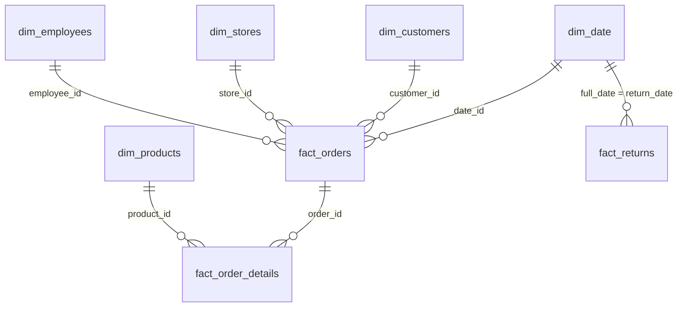

<h1 align="center">Lotus Group Retail Analytics: Data Model</h1>

# Purpose

This document describes the analytical data model behind the Lotus Group Power BI report: its structure, the relationships between tables, and the design decisions behind them.

For column-level detail, see [`data_dictionary.md`](data_dictionary.md). For how the tables were cleaned before modelling, see [`transformations_log.md`](../03_power_query/transformations_log.md).

---

# 1. Modelling approach

The model is a **star schema** (dimensional model):

- **Fact tables** record business events: orders, order lines and returns.
- **Dimension tables** describe the *who, what, where and when* of those events: customers, products, stores, employees and dates.

A star schema was chosen because it:
- keeps relationships simple and filter behaviour predictable
- performs well in Power BI's VertiPaq engine
- lets one set of DAX measures work across every report page
- is easy for business users to understand and explore

---

# 2. Model overview

**8 tables loaded:** 5 dimensions and 3 facts.

| Table | Type | Grain | Rows |
|---|---|---|---|
| `dim_date` | Dimension | One row per calendar day | 1,096 |
| `dim_customers` | Dimension | One row per customer | 3,000 |
| `dim_stores` | Dimension | One row per store | 15 |
| `dim_employees` | Dimension | One row per employee | 216 |
| `dim_products` | Dimension | One row per product | 345 |
| `fact_orders` | Fact (header) | One row per order | 12,000 |
| `fact_order_details` | Fact (line) | One row per product on an order | 25,099 |
| `fact_returns` | Fact | One row per return | 1,056 |

**Staging queries (not loaded):** `fact_orders_2022_2023` and `fact_orders_2024`. They're appended to form `fact_orders` and kept for traceability.

**Measures table:** `_Measures`, an empty table that holds all 25 DAX measures in one place.

---

# 3. Model diagram



Text version:

```
   dim_customers     dim_stores      dim_employees
          \               |               /
           \              |              /
            ▼             ▼             ▼
dim_date ──────────►  fact_orders
   │                      │
   │                      ▼
   │              fact_order_details ◄────── dim_products
   │
   └──────────────►  fact_returns
```

The model covers two business processes:

| Process | Flow |
|---|---|
| **Sales** | Customers, Stores, Employees and Dates → Orders → Order Details ← Products |
| **Returns** | Dates → Returns |

---

# 4. Relationships

| # | From (one side) | To (many side) | Cardinality | Filter direction | Active |
|---|---|---|---|---|---|
| 1 | `dim_date[date_id]` | `fact_orders[date_id]` | 1 : * | Single | Yes |
| 2 | `dim_customers[customer_id]` | `fact_orders[customer_id]` | 1 : * | Single | Yes |
| 3 | `dim_stores[store_id]` | `fact_orders[store_id]` | 1 : * | Single | Yes |
| 4 | `dim_employees[employee_id]` | `fact_orders[employee_id]` | 1 : * | Single | Yes |
| 5 | `fact_orders[order_id]` | `fact_order_details[order_id]` | 1 : * | Single | Yes |
| 6 | `dim_products[product_id]` | `fact_order_details[product_id]` | 1 : * | Single | Yes |
| 7 | `dim_date[full_date]` | `fact_returns[return_date]` | 1 : * | Single | Yes |

**Referential integrity checks (all passed)**
- Every `customer_id`, `store_id` and non-null `employee_id` in `fact_orders` exists in its dimension.
- Every `product_id` in `fact_order_details` exists in `dim_products`.
- Every `order_id` in `fact_order_details` and `fact_returns` exists in `fact_orders`.
- Every `fact_orders[total_revenue]` equals the sum of that order's `line_total_revenue`.

---

# 5. Design decisions

### 5.1 Two levels of grain: order header and order lines

Orders are stored at two levels:
- `fact_orders` holds one row per order, with attributes about the order: who, where, when, how it was paid and its status.
- `fact_order_details` holds one row per product on an order: what was sold, how many, and at what price.

**Decision:** keep both tables and link them with `fact_orders[order_id] → fact_order_details[order_id]`.

**Why:** product questions need line-level data, and customer, store and employee questions need order-level data. Combining them into one table would duplicate order attributes across lines and make order counts error-prone.

**Effect:** filters from date, customer, store and employee flow from `fact_orders` down to `fact_order_details`, so product-level measures such as Total Sales respond to every slicer.

### 5.2 Order lines are the source of truth for sales

**Decision:** Total Sales, Total Cost and Units Sold are calculated from `fact_order_details`, not from the header totals in `fact_orders`.

**Why:** line-level data is the only place where sales can be split by product, category and subcategory. The header totals were checked and match the line totals in every order, so either would give the same group figures, but only the lines work for product analysis.

### 5.3 Orders without an employee are kept

**Decision:** the 632 orders with no `employee_id` stay in the model.

**Why:** removing them would remove real revenue from every report. The missing ID is a data-capture problem, not a sign that the orders are invalid.

**Effect:** in employee visuals these orders appear under a *(Blank)* employee. The **Employee Attribution Rate %** measure makes the gap visible instead of hiding it.

### 5.4 Returns link to dates only

`fact_returns` has no `date_id`, so it joins to `dim_date` on `full_date = return_date`.

**Decision:** in this version, returns connect to the date dimension only.

**Why:** a `fact_orders → fact_returns` relationship would allow returns to be filtered by store, customer and employee. But it would add a second filter path from `dim_date` (through `fact_orders` and through `return_date`), which creates ambiguity. Keeping one clear date path was prioritised.

**Effect:** returns can be analysed by year, quarter, month, day, Ramadan and weekend, but not yet by store, product or customer.

**Possible extension:** bring `store_id` and `customer_id` into `fact_returns` in Power Query (by merging on `order_id`), then relate returns directly to `dim_stores` and `dim_customers`. This keeps a single path from each dimension.

### 5.5 Single-direction filtering throughout

**Decision:** all relationships filter one way, from dimension to fact.

**Why:** bidirectional filters can create ambiguous paths and unexpected totals, and they slow the model down. No report requirement needed them.

### 5.6 A dedicated measures table

**Decision:** all measures live in `_Measures` rather than in the fact tables.

**Why:** it gives report builders one place to find every calculation and keeps the fact tables free of clutter.

---

# 6. Date table configuration

- `dim_date` is **marked as a date table** on `full_date`, which time-intelligence functions such as `TOTALYTD` and `SAMEPERIODLASTYEAR` require.
- It covers every day from 1 Jan 2022 to 31 Dec 2024 with no gaps.
- `month_name` is sorted by `month`, and `day_name` by `day_of_week`, so visuals display in calendar order.
- Business flags `is_weekend` (Friday–Saturday) and `is_ramadan` drive the seasonality measures.

---

# 7. How the model answers the business questions

| Question | Tables used |
|---|---|
| How are sales and margin changing over time? | `dim_date` → `fact_orders` → `fact_order_details` |
| Which categories and products drive revenue and profit? | `dim_products` → `fact_order_details` |
| Which stores and regions perform best? | `dim_stores` → `fact_orders` → `fact_order_details` |
| Who are the most valuable customers and tiers? | `dim_customers` → `fact_orders` → `fact_order_details` |
| How much sales activity is attributed to employees? | `dim_employees` → `fact_orders` |
| What does Ramadan or the weekend do to sales? | `dim_date[is_ramadan]`, `dim_date[is_weekend]` → facts |
| How much is returned, when and why? | `dim_date` → `fact_returns` |
