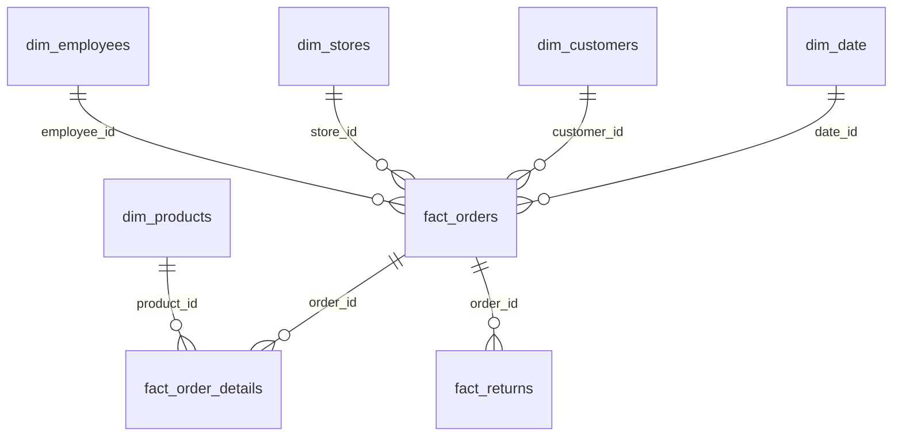

<h1 align="center">Lotus Group Retail Analytics: Data Model</h1>

# Purpose

This document describes the analytical data model behind the Lotus Group Power BI report: its structure, the relationships between tables, and the design decisions behind them.

For column-level detail, see [`data_dictionary.md`](data_dictionary.md). For how the tables were cleaned before modelling, see [`transformations_log.md`](../03_powerbi_analysis/power_query/transformations_log.md).

---

# 1. Modelling approach

The model is a **star schema** (dimensional model):

- **Fact tables** record business events: orders, order lines and returns.
- **Dimension tables** describe the *who, what, where and when* of those events: customers, products, stores, employees and dates.

A star schema was chosen because it:
- keeps relationships simple and filter behaviour predictable
- performs well in Power BI's VertiPaq engine
- lets one set of DAX measures work across every report page
- is easy for business users to understand and explore

---

# 2. Model overview

**8 tables loaded:** 5 dimensions and 3 facts, plus 3 small helper tables.

| Table | Type | Grain | Rows |
|---|---|---|---|
| `dim_date` | Dimension | One row per calendar day | 1,096 |
| `dim_customers` | Dimension | One row per customer | 3,000 |
| `dim_stores` | Dimension | One row per store | 15 |
| `dim_employees` | Dimension | One row per employee | 216 |
| `dim_products` | Dimension | One row per product | 345 |
| `fact_orders` | Fact (header) | One row per order | 12,000 |
| `fact_order_details` | Fact (line) | One row per product on an order | 25,099 |
| `fact_returns` | Fact | One row per return | 1,056 |

**Staging queries (not loaded):** `fact_orders_2022_2023` and `fact_orders_2024`. They're appended to form `fact_orders` and kept for traceability.

**Helper tables (DAX, no relationships):**

| Table | Purpose |
|---|---|
| `CustomerDecile` | Axis for the revenue-concentration curve on the Customers page (Top 10% … All) |
| `Share Metric` | Axis for the "share of sales vs share of profit" chart on the Executive Overview |
| `RefreshInfo` | Hidden; stores the time of the last refresh for the page footers |

**Measures table:** `_Measures` holds every DAX measure, organised into display folders: Core, Prior Year, KPI Tiles, Colours, Titles and Labels. See [`DAX_measures_catalog.md`](../03_powerbi_analysis/DAX/DAX_measures_catalog.md).

**Auto date/time is switched off**, so Power BI doesn't create hidden date tables for every date column. All date logic goes through `dim_date`.

---

# 3. Model diagram



Text version:

```
   dim_customers     dim_stores      dim_employees
          \               |               /
           \              |              /
            ▼             ▼             ▼
dim_date ──────────►  fact_orders ──────────►  fact_returns
                          │
                          ▼
                  fact_order_details ◄────── dim_products
```

The model covers two business processes:

| Process | Flow |
|---|---|
| **Sales** | Customers, Stores, Employees and Dates → Orders → Order Details ← Products |
| **Returns** | Customers, Stores, Employees and Dates → Orders → Returns |

---

# 4. Relationships

| # | From (one side) | To (many side) | Cardinality | Filter direction | Active |
|---|---|---|---|---|---|
| 1 | `dim_date[date_id]` | `fact_orders[date_id]` | 1 : * | Single | Yes |
| 2 | `dim_customers[customer_id]` | `fact_orders[customer_id]` | 1 : * | Single | Yes |
| 3 | `dim_stores[store_id]` | `fact_orders[store_id]` | 1 : * | Single | Yes |
| 4 | `dim_employees[employee_id]` | `fact_orders[employee_id]` | 1 : * | Single | Yes |
| 5 | `fact_orders[order_id]` | `fact_order_details[order_id]` | 1 : * | Single | Yes |
| 6 | `dim_products[product_id]` | `fact_order_details[product_id]` | 1 : * | Single | Yes |
| 7 | `fact_orders[order_id]` | `fact_returns[order_id]` | 1 : * | Single | Yes |

**Referential integrity checks (all passed)**
- Every `customer_id`, `store_id` and non-null `employee_id` in `fact_orders` exists in its dimension.
- Every `product_id` in `fact_order_details` exists in `dim_products`.
- Every `order_id` in `fact_order_details` and `fact_returns` exists in `fact_orders`.
- Every `fact_orders[total_revenue]` equals the sum of that order's `line_total_revenue`.

---

# 5. Design decisions

### 5.1 Two levels of grain: order header and order lines

Orders are stored at two levels:
- `fact_orders` holds one row per order, with attributes about the order: who, where, when, how it was paid and its status.
- `fact_order_details` holds one row per product on an order: what was sold, how many, and at what price.

**Decision:** keep both tables and link them with `fact_orders[order_id] → fact_order_details[order_id]`.

**Why:** product questions need line-level data, and customer, store and employee questions need order-level data. Combining them into one table would duplicate order attributes across lines and make order counts error-prone.

**Effect:** filters from date, customer, store and employee flow from `fact_orders` down to `fact_order_details`, so product-level measures such as Total Sales respond to every slicer.

### 5.2 Order lines are the source of truth for sales

**Decision:** Total Sales, Total Cost and Units Sold are calculated from `fact_order_details`, not from the header totals in `fact_orders`.

**Why:** line-level data is the only place where sales can be split by product, category and subcategory. The header totals were checked and match the line totals in every order, so either would give the same group figures, but only the lines work for product analysis.

### 5.3 Orders without an employee are kept, but kept out of employee rankings

**Decision:** the 632 orders with no `employee_id` stay in the model.

**Why:** removing them would remove real revenue from every report. The missing ID is a data-capture problem, not a sign that the orders are invalid.

**Effect:** company totals include these orders. Employee rankings use **Attributed Sales** and **Orders with Employee ID**, which only count orders with an employee, so the orders never appear as a *(Blank)* employee. The **Employee Attribution Rate %** KPI and the "orders with no employee, by store" chart make the gap visible instead of hiding it.

### 5.4 Returns link to orders

**Decision:** `fact_returns` joins to `fact_orders` on `order_id` (one return per order).

**Why:** this gives returns the same filter path as sales. The Year, Region and Category slicers, and the store, customer and employee dimensions, all reach returns through the order, so every return-rate figure compares like with like. An earlier version linked returns to dates only, through `return_date`; that meant store and region slicers had no effect on returns.

**Effect:** returns are dated by the **order date**, not the date the return was logged. A December order returned in January counts in December. This keeps "returned value ÷ sales" consistent, because both sides of the ratio use the same date. `return_date` stays in the table for reference.

### 5.5 Single-direction relationships, with targeted cross-filtering in measures

**Decision:** all relationships filter one way, from dimension to fact.

**Why:** bidirectional relationships can create ambiguous paths and unexpected totals, and slow the model down.

**Exception, handled in DAX:** the Category slicer filters `dim_products`, which reaches order lines but not order headers. So that order, customer and return counts also respond to it, five measures (`Total Orders`, `Total Customers`, `Returned Amount`, `Number of Returns`, `Total Orders Returned`) switch on two-way filtering between order lines and orders inside the measure only, with `CROSSFILTER ( fact_order_details[order_id], fact_orders[order_id], BOTH )`. The relationship itself stays single-direction.

### 5.6 A dedicated measures table

**Decision:** all measures live in `_Measures` rather than in the fact tables, grouped into display folders.

**Why:** it gives report builders one place to find every calculation and keeps the fact tables free of clutter.

### 5.7 Prior-year comparisons use explicit year logic

**Decision:** prior-year measures (`Sales PY`, `Gross Profit PY` and so on) shift the selected year back by one: `CALCULATE ( [measure], dim_date[year] = SELECTEDVALUE ( dim_date[year] ) - 1 )`.

**Why:** the report filters by a Year slicer, and `dim_date` joins on `date_id`. Built-in time-intelligence functions such as `SAMEPERIODLASTYEAR` need a marked date table and return blank under a year filter in this setup. The explicit version works with any slicer combination and returns blank when no single year is selected, so the "vs prior year" text switches off cleanly.

---

# 6. Date table configuration

- `dim_date` covers every day from 1 Jan 2022 to 31 Dec 2024 with no gaps, and joins to `fact_orders` on `date_id`.
- `month_name` and `short_month` are sorted by `month`, and `day_name` by `day_of_week`, so visuals display in calendar order.
- Business flags `is_weekend` (Friday–Saturday) and `is_ramadan` drive the seasonality measures. `Period Type` (Ramadan / Rest of year) is sorted by `is_ramadan`.
- Auto date/time is off, so there are no hidden date tables.

---

# 7. How the model answers the business questions

| Question | Tables used |
|---|---|
| How are sales and margin changing over time? | `dim_date` → `fact_orders` → `fact_order_details` |
| Which categories and products drive revenue and profit? | `dim_products` → `fact_order_details` |
| Which stores and regions perform best, for their size? | `dim_stores` → `fact_orders` → `fact_order_details` |
| Who are the most valuable customers, and do loyalty tiers reflect them? | `dim_customers` → `fact_orders` → `fact_order_details` |
| How much sales activity is attributed to employees? | `dim_employees` → `fact_orders` |
| What does Ramadan or the weekend do to sales? | `dim_date[is_ramadan]`, `dim_date[is_weekend]` → facts |
| How much is returned, why, and where? | `dim_date`, `dim_stores` → `fact_orders` → `fact_returns` |
