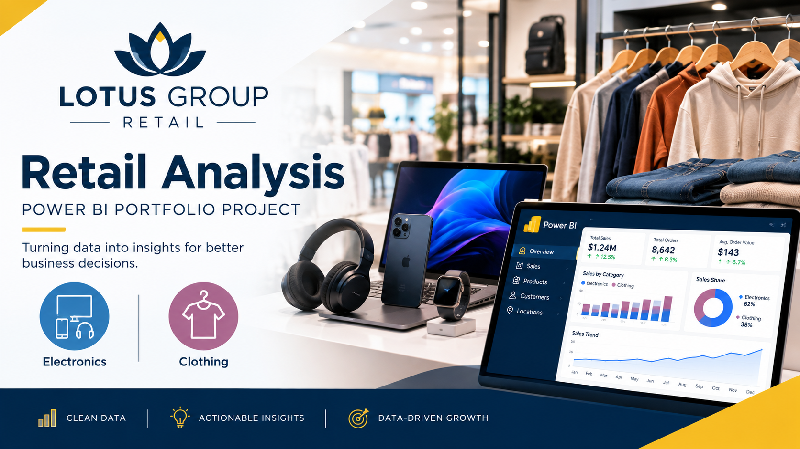
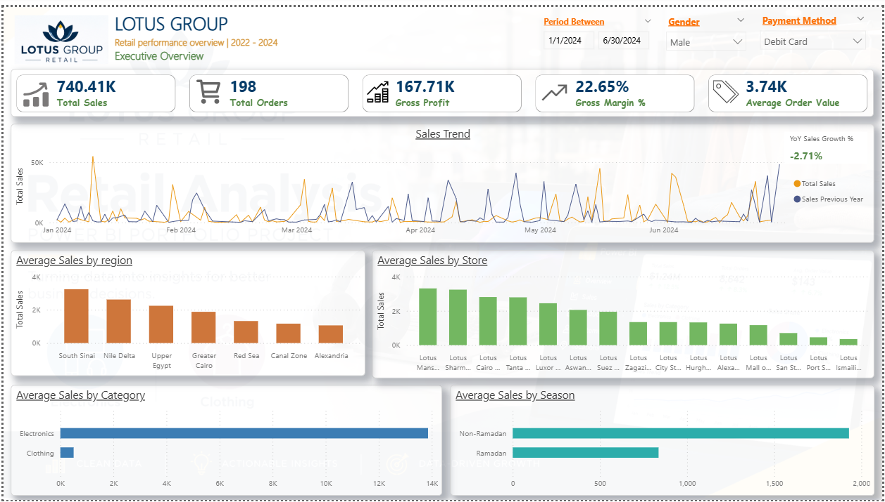
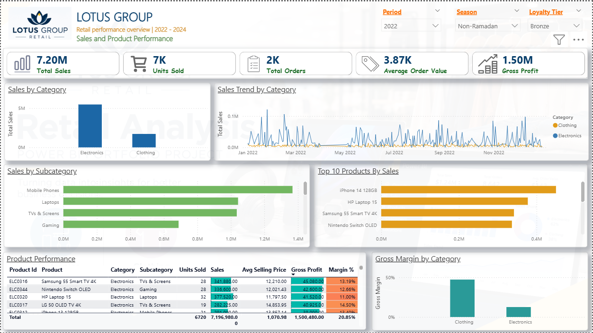
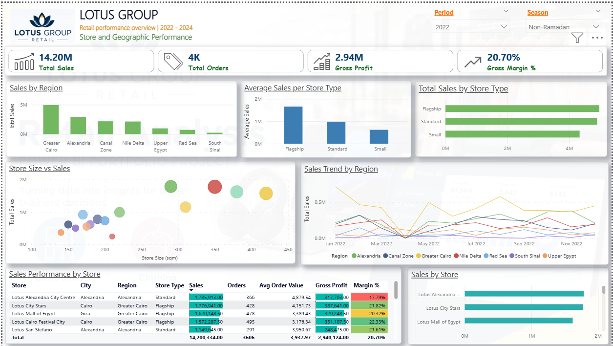
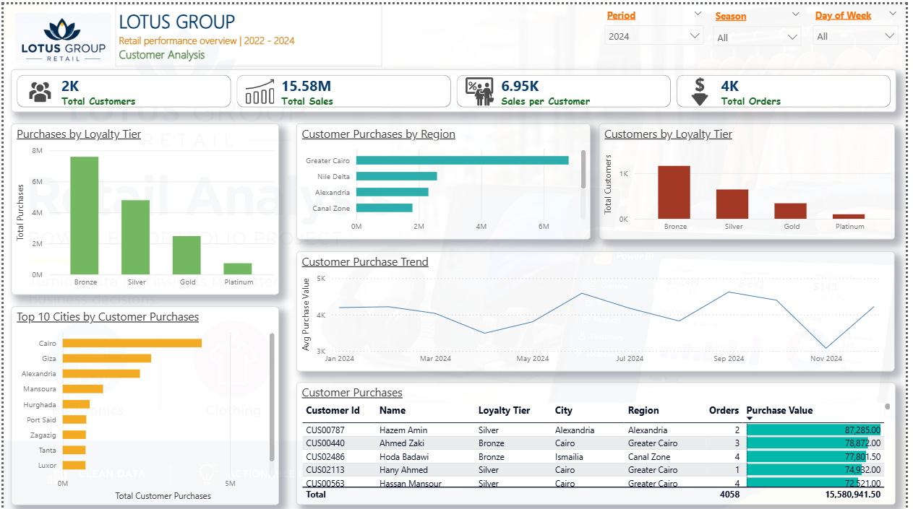
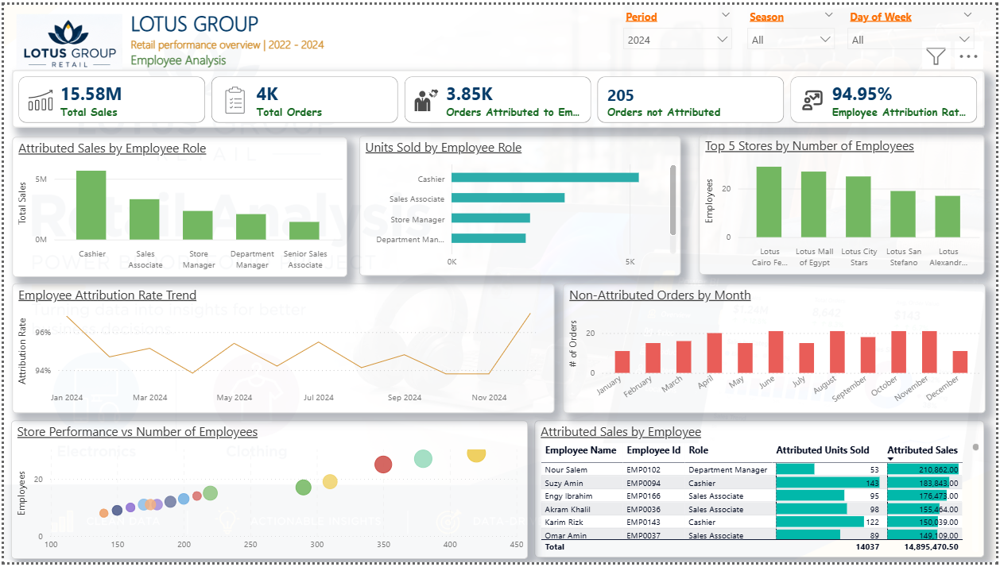
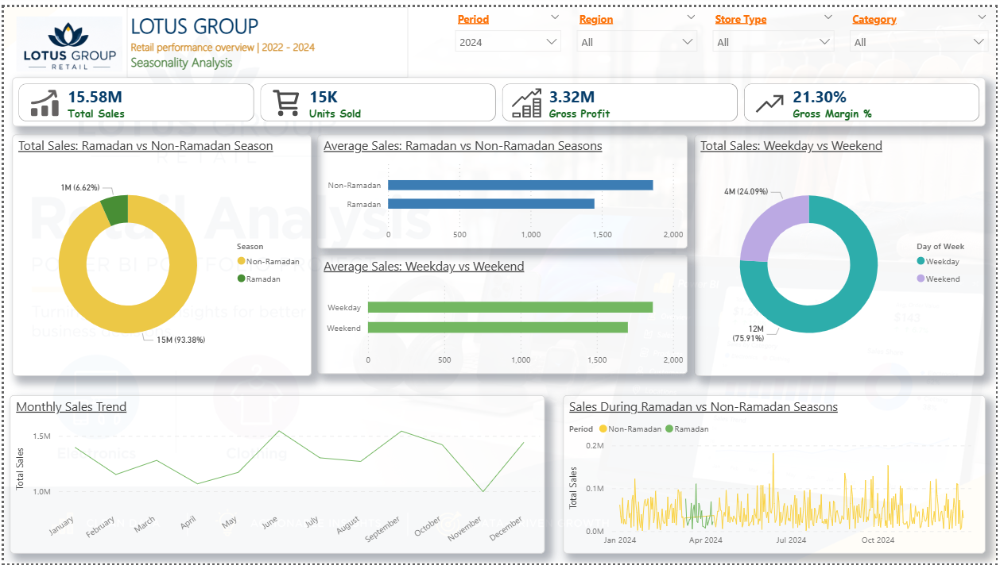
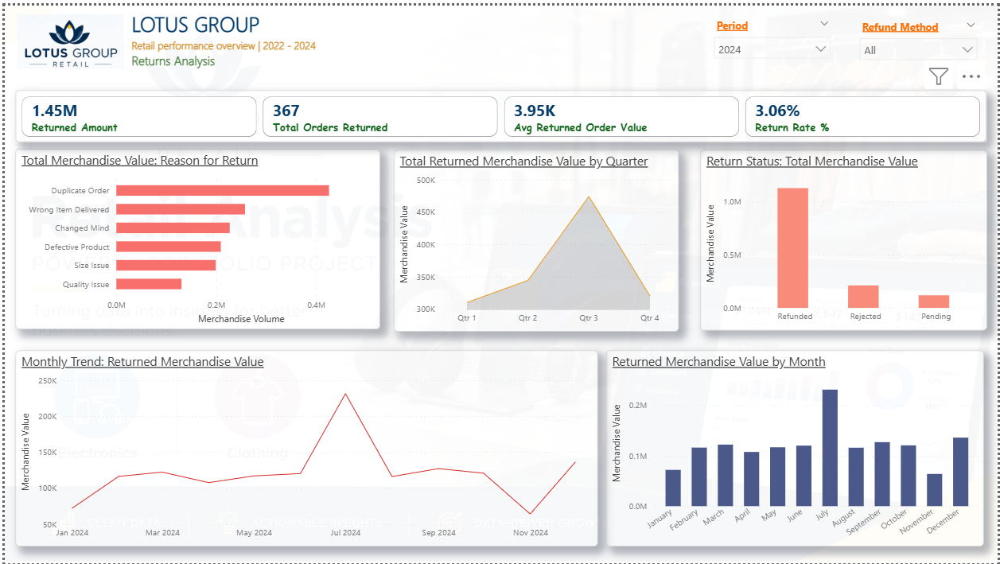

<h1 align="center">Lotus Group Retail Analytics</h1>

<p align="center">

</p>

<p align="center">
<b>A Power BI analysis of a 15-store Egyptian retail chain (EGP 45.4M in sales, 12,000 orders, 2022–2024). It found that clothing earns 54% of gross profit from just 24% of sales.</b>
</p>

<p align="center">
<code>Power BI</code> · <code>Power Query</code> · <code>DAX</code> · <code>Star-schema modelling</code> · <code>Data quality auditing</code> · <code>7-page interactive report</code>
</p>

---

## At a glance

| | |
|---|---|
| **Revenue analysed** | EGP 45.4M across 12,000 orders and 43,300 units |
| **Gross margin** | 21.4% overall: 47.4% on clothing vs 13.1% on electronics |
| **Growth** | Sales fell 4.8% in 2023, then recovered 7.3% in 2024 |
| **Customer concentration** | The top 20% of customers drive 59% of revenue |
| **Returns** | 8.8% of orders are returned. 37% of returned value comes from operational errors such as duplicate orders and wrong items |
| **Deliverable** | 7-page interactive Power BI report, documented data model and 25 reusable DAX measures |

---

## 1. The problem

> *"Client runs 15 stores across Egypt selling clothing and electronics. Their sales data is spread across nine separate tables, and they don't trust some of it. They need one place to see where revenue and profit actually come from, which stores and customers matter most, what Ramadan does to sales, and why customers return products."*

Lotus Group's management had operational data but no single, trustworthy view of performance. The job was to clean and model the data, build a reporting layer, and turn it into clear answers on sales, products, stores, customers, staff, seasonality and returns.

---

## 2. The data

| | |
|---|---|
| **Source** | Lotus Group operational exports (a fictional, educational dataset, see the [disclaimer](#data-disclaimer)) |
| **Size** | 9 raw CSV tables, ~43,000 rows in total |
| **Time range** | 1 Jan 2022 – 31 Dec 2024 (3 full years, including 3 Ramadan seasons) |
| **Scope** | 15 stores in 7 regions · 3,000 customers · 345 products · 216 employees · 25,099 order lines · 1,056 returns |

The data contained the kinds of problems real client data has, and each one was investigated and documented before anything was built:

- **50 exact duplicate customer records** (3,050 rows but only 3,000 customers). They were removed.
- **632 orders (5.3%) with no employee recorded.** They were kept so that no revenue was lost, and flagged with an attribution-rate KPI.
- **Orders split across two tables** (2022–23 and 2024). They were appended into one fact table.
- **Wrong data types** (phone numbers stored as integers, dates stored as text) and **inconsistent category labels**. Both were fixed.
- **Missing customer emails.** These were left blank on purpose rather than filled with invented values.

---

## 3. Approach

```
Raw CSVs → Profiling & quality audit → Power Query cleaning → Star-schema model → DAX measures → 7-page report → Insights
```

1. **Profiling and data-quality audit.** Every table was checked for row counts, key uniqueness, nulls, duplicates, date ranges and referential integrity. → [`data_quality_assessment.md`](02_documentation/data_quality_assessment.md)
2. **Cleaning and transformation in Power Query.** Duplicates were removed, data types fixed, labels standardised and the order tables appended. Every step was logged with its reason. → [`transformations_log.md`](03_power_query/transformations_log.md)
3. **Data modelling.** A star schema with 5 dimension tables (date, customers, stores, employees, products) and 3 fact tables (orders, order lines, returns), joined by one-to-many relationships with single-direction filters.
4. **DAX measure layer.** 25 reusable measures cover sales, margin, AOV, YoY growth, YTD, return rate, Ramadan vs non-Ramadan and weekend vs weekday sales, and employee attribution rate. → [`DAX_measures_catalog.md`](04_DAX/DAX_measures_catalog.md)
5. **Report design.** Seven pages, each built around one stakeholder's questions: Executive, Sales & Product, Store & Geography, Customers, Employees, Seasonality and Returns.

**Tools:** Power BI Desktop · Power Query (M) · DAX · Git/GitHub

---

## 4. Results

### Executive overview

<p align="center">

</p>

### Sales and product performance

<p align="center">

</p>

### Key findings

**1. Electronics brings in the revenue, but clothing brings in the profit.**
Electronics accounts for 76% of sales but earns only a 13.1% margin. Clothing accounts for 24% of sales at a 47.4% margin, which makes it **54% of total gross profit** (EGP 5.2M vs 4.5M).

**2. Three flagship stores carry the business.**
The three Greater Cairo flagships produce **37% of all sales**. The seven Small-format stores produce 29% between them, and each one averages about a third of a flagship's revenue.

**3. Revenue is highly concentrated in a small group of customers.**
The **top 20% of customers generate 59% of revenue**, and the top 10% generate 39%. However, average spend per customer is almost the same in every loyalty tier (about EGP 15–16K), so the loyalty programme isn't identifying the high-value customers.

**4. Ramadan lowers electronics sales but not clothing.**
Average daily sales are **14% lower during Ramadan**. All of that drop comes from electronics (-19% per day). Clothing sales hold steady and rise slightly (+3%).

**5. Over a third of returned value could be prevented.**
Returns total EGP 4.0M (8.8% of sales value). The largest single reason is **duplicate orders (21% of returned value)**, and wrong items delivered add another 16%. Both are process failures, not product problems.

**6. Sales recovered in 2024.**
After a 4.8% fall in 2023, sales grew **7.3% in 2024** to EGP 15.6M. Margin held steady at about 21% throughout.

<details>
<summary><b>See the other 5 report pages</b></summary>

#### Store and geographic performance


#### Customer analysis


#### Employee analysis


#### Seasonality analysis


#### Returns analysis


</details>

---

## 5. Recommendations

1. **Grow and protect clothing.** It earns more than half the gross profit. Give it more floor space, marketing and stock depth, especially in the Small stores, where higher-margin goods matter most.
2. **Use electronics to bring customers in, and sell high-margin add-ons alongside it.** Bundle accessories, warranties and audio products with laptops, phones and TVs to raise the 13% margin.
3. **Fix the checkout and fulfilment problems behind returns.** Adding duplicate-order detection at the point of sale and pick-and-pack checks could prevent up to EGP 1.5M in returns over a period like this one.
4. **Redesign the loyalty tiers around actual spend.** The top 20% of customers should be in the top tiers. At the moment, half of all revenue comes from Bronze members.
5. **Plan electronics promotions around Ramadan.** Shift electronics campaigns to the weeks before and after Ramadan, and push clothing (Eid outfits) during it.
6. **Make staff record the employee on every order.** About 5% of orders can't be credited to anyone, which weakens any commission or performance analysis.

---

## 6. How to run

**Requirements:** Power BI Desktop (Windows, free)

```bash
git clone https://github.com/Vin-Okumu/lotus-group-retail-analytics.git
```

1. Open `05_power_bi/lotus-group-retail-analytics.pbix` in Power BI Desktop.
2. If prompted, go to **Transform data → Data source settings** and point the source to your local `01_data/raw/` folder, then click **Refresh**.
3. No Power BI? A static export of the full report is in [`05_power_bi/lotus-group-retail-analytics.pdf`](05_power_bi/lotus-group-retail-analytics.pdf).

### Repository structure

```
lotus-group-retail-analytics/
├── 01_data/raw/                  # 9 source CSV tables
├── 02_documentation/             # Business requirements, data-quality audit, project breakdown
├── 03_power_query/               # Transformation plan, notes and step-by-step log
├── 04_DAX/                       # Catalogue of every DAX measure with its logic
├── 05_power_bi/
│   ├── lotus-group-retail-analytics.pbix
│   ├── lotus-group-retail-analytics.pdf
│   └── screenshots/
├── 06_analysis/                  # Business insights
└── README.md
```

---

### Data disclaimer

This project uses a **fictional, educational dataset**. The company, customers, employees and transactions are not real and do not represent any actual business. Figures are in Egyptian pounds (EGP).

---

**Vincent Okumu** · Data Analyst / BI Developer

*Open to freelance Power BI, Power Query and retail analytics work.*
