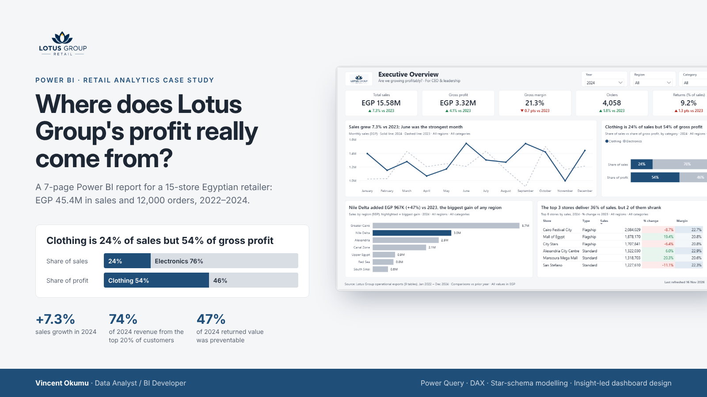
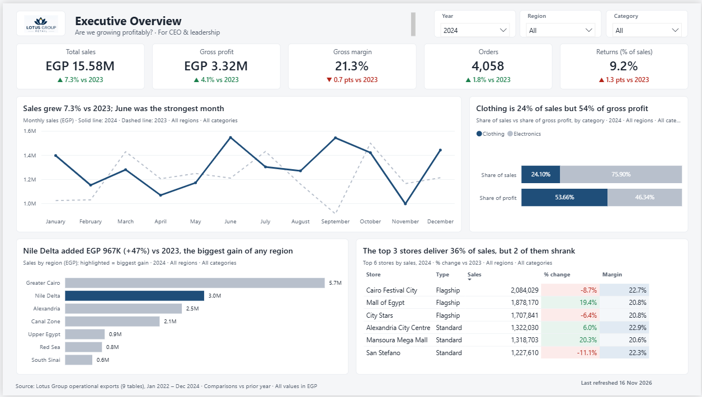
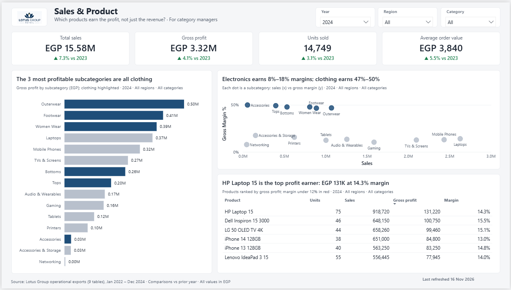
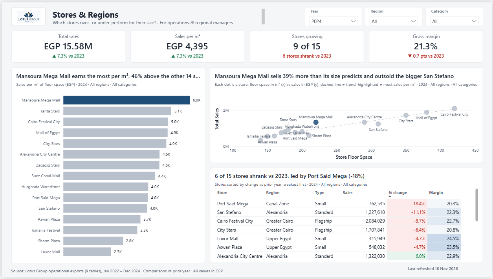
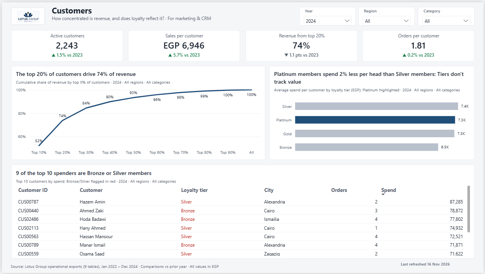
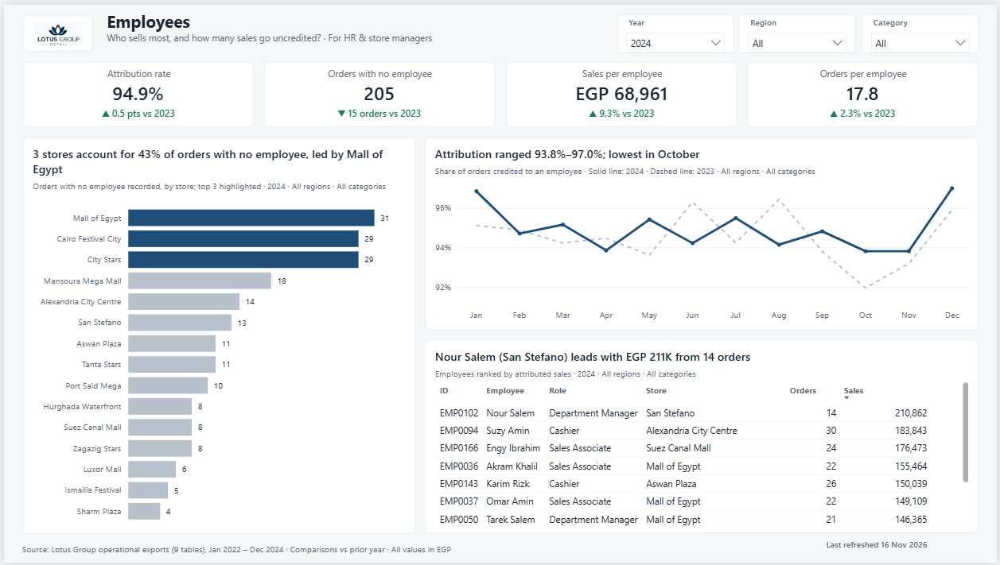
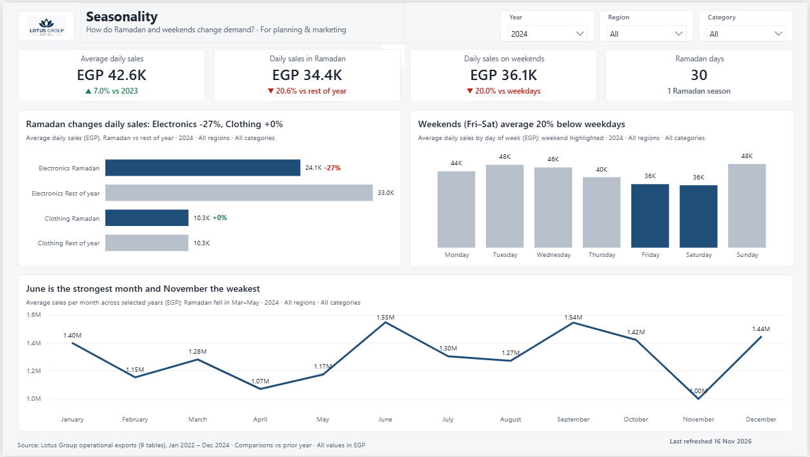
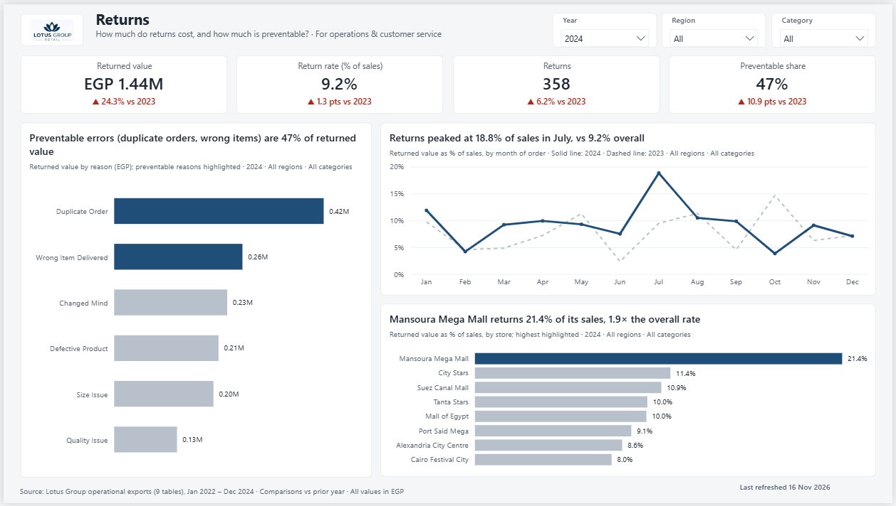

<h1 align="center">Lotus Group Retail Analytics</h1>

<p align="center">

</p>

<p align="center">
<b>A 7-page Power BI report for a 15-store Egyptian retail chain (EGP 45.4M in sales, 12,000 orders, 2022–2024). It found that clothing earns 54% of gross profit from just 24% of sales.</b>
</p>

<p align="center">
<code>Power BI</code> · <code>Power Query</code> · <code>DAX</code> · <code>Star-schema modelling</code> · <code>Data quality auditing</code> · <code>Insight-led dashboard design</code>
</p>

---

## In 30 seconds: question → insight → action

| Business question | What the data shows | Recommended action |
|---|---|---|
| Where does our profit actually come from? | Electronics is 76% of sales at a 13.1% margin. Clothing is 24% of sales at 47.4%, which makes it **54% of gross profit**. | Give clothing more floor space and stock depth; bundle high-margin add-ons with electronics. |
| Which customers matter most? | The **top 20% of customers drive 74% of 2024 revenue**, yet 9 of the top 10 spenders are Bronze or Silver members. | Rebuild loyalty tiers around actual spend so top spenders sit in the top tiers. |
| Why do customers return products? | Returns were **9.2% of 2024 sales**, and **47% of returned value** came from duplicate orders and wrong items. | Add duplicate-order checks at checkout and pick-and-pack verification. |
| What does Ramadan do to sales? | Daily sales fall **14%** during Ramadan, all of it from electronics (−19%); clothing rises 3%. | Move electronics promotions to the weeks before and after Ramadan; push Eid clothing during it. |

---

## 1. The problem

> *"Client runs 15 stores across Egypt selling clothing and electronics. Their sales data is spread across nine separate tables, and they don't trust some of it. They need one place to see where revenue and profit actually come from, which stores and customers matter most, what Ramadan does to sales, and why customers return products."*

Lotus Group's management had operational data but no single, trustworthy view of performance. The job was to clean and model the data, build a reporting layer, and turn it into clear answers on sales, products, stores, customers, staff, seasonality and returns.

### Who the report is for

| Page | Built for | Question it answers |
|---|---|---|
| Executive Overview | CEO / leadership | Are we growing profitably? |
| Sales & Product | Category managers | Which products earn the profit, not just the revenue? |
| Stores & Regions | Operations / regional managers | Which stores over- or under-perform for their size? |
| Customers | Marketing / CRM | How concentrated is revenue, and does loyalty reflect it? |
| Employees | HR / store managers | Who sells most, and how many sales go uncredited? |
| Seasonality | Planning / marketing | How do Ramadan and weekends change demand? |
| Returns | Operations / customer service | How much do returns cost, and how much is preventable? |

---

## 2. The data

| | |
|---|---|
| **Source** | Lotus Group operational exports (a fictional, educational dataset, see the [disclaimer](#data-disclaimer)) |
| **Size** | 9 raw CSV tables, ~43,000 rows in total |
| **Time range** | 1 Jan 2022 – 31 Dec 2024 (3 full years, including 3 Ramadan seasons) |
| **Scope** | 15 stores in 7 regions · 3,000 customers · 345 products · 216 employees · 25,099 order lines · 1,056 returns |

The data contained the kinds of problems real client data has, and each one was investigated and documented before anything was built:

- **50 exact duplicate customer records** (3,050 rows but only 3,000 customers). They were removed.
- **632 orders (5.3%) with no employee recorded.** They were kept so that no revenue was lost, excluded from employee rankings, and tracked with an attribution-rate KPI.
- **Orders split across two tables** (2022–23 and 2024). They were appended into one fact table.
- **Wrong data types** (phone numbers stored as integers, dates stored as text) and **inconsistent category labels**. Both were fixed.
- **Missing customer emails.** These were left blank on purpose rather than filled with invented values.

→ Full audit: [`data_quality_assessment.md`](02_documentation/data_quality_assessment.md) · Raw data notes: [`01_data/README.md`](01_data/README.md)

---

## 3. Approach

```
Raw CSVs → Profiling & quality audit → Power Query cleaning → Star-schema model → DAX measures → 7-page report → Insights
```

1. **Profiling and data-quality audit.** Every table was checked for row counts, key uniqueness, nulls, duplicates, date ranges and referential integrity. → [`data_quality_assessment.md`](02_documentation/data_quality_assessment.md)
2. **Cleaning and transformation in Power Query.** Duplicates were removed, data types fixed, labels standardised and the order tables appended. Every step was logged with its reason. → [`transformations_log.md`](03_powerbi_analysis/power_query/transformations_log.md)
3. **Data modelling.** A star schema with 5 dimension tables (date, customers, stores, employees, products) and 3 fact tables (orders, order lines, returns). Returns link to orders, so every slicer filters every page. → [`data_model.md`](02_documentation/data_model.md) · [`data_dictionary.md`](02_documentation/data_dictionary.md)
4. **DAX measure layer.** About 215 measures in display folders: core measures for sales, margin, AOV, return rate, Ramadan and weekend effects and employee attribution, plus prior-year comparisons, KPI change indicators, highlight colours and **dynamic titles that restate the finding whenever a slicer changes**. → [`DAX_measures_catalog.md`](03_powerbi_analysis/DAX/DAX_measures_catalog.md)
5. **Report design.** Seven pages with one consistent layout: KPI cards with a change vs the prior year across the top, trends in the middle, breakdowns and detail tables at the bottom. One accent colour marks what to look at; red and green are used only for good and bad. Year, Region and Category slicers sit in the same place on every page.

**Tools:** Power BI Desktop · Power Query (M) · DAX · Power BI Project format (PBIP/TMDL) · Git/GitHub

---

## 4. Results

> Screenshots show 2024 compared with 2023 (Seasonality shows all three years). Findings note which period they cover.

### Executive overview

<p align="center">

</p>

### Key findings

#### **1. Electronics brings in the revenue, but clothing brings in the profit.** *(2022–2024)*
Electronics accounts for 76% of sales but earns only a 13.1% margin. Clothing accounts for 24% of sales at a 47.4% margin, which makes it **54% of total gross profit** (EGP 5.2M vs 4.5M). The three most profitable subcategories (outerwear, footwear and womenswear) are all clothing.

<p align="center">

</p>

#### **2. Three flagship stores carry the business, but a mid-size store uses its space best.** *(2024)*
The three Greater Cairo flagships produce **36% of sales**, though two of them shrank in 2024. **Mansoura Mega Mall** earns the most per m² (EGP 6.0K, 46% above the other stores' average) and sells 39% more than its size predicts. Nile Delta added EGP 967K (+47%), the biggest gain of any region.

#### **3. Revenue is highly concentrated, and the loyalty tiers don't reflect it.** *(2024)*
The **top 20% of customers drive 74% of revenue**. Platinum members spend slightly less per head than Silver members, and **9 of the top 10 spenders are Bronze or Silver members**.

#### **4. Ramadan lowers electronics sales but not clothing.** *(2022–2024)*
Average daily sales are **14% lower during Ramadan**. All of that drop comes from electronics (−19% per day); clothing rises slightly (+3%). Weekends (Friday–Saturday) average 11% below weekdays.

#### **5. Almost half of returned value could be prevented.** *(2024)*
Returns reached **EGP 1.44M, 9.2% of sales**, up from 8.0% in 2023. Duplicate orders and wrong items make up **47% of returned value**, and **Mansoura Mega Mall returns 21.4% of its sales**, 2.3× the overall rate.

#### **6. Sales recovered in 2024, but margin slipped.** *(2023–2024)*
After a 4.8% fall in 2023, sales grew **7.3% in 2024** to EGP 15.6M, while gross margin slipped 0.7 points to 21.3%.

<details>
<summary><b>See the other 5 report pages</b></summary>

#### Stores & Regions


#### Customers


#### Employees


#### Seasonality


#### Returns


</details>

→ Full write-up: [`business_insights.md`](04_report/business_insights.md) · Findings deck: [`Lotus_Group_Retail_Analytics.pptx`](04_report/Lotus_Group_Retail_Analytics.pptx)

---

## 5. Recommendations

1. **Grow and protect clothing.** It earns more than half the gross profit. Give it more floor space, marketing and stock depth, especially in the Small stores, where higher-margin goods matter most.
2. **Use electronics to bring customers in, and sell high-margin add-ons alongside it.** Bundle accessories, warranties and audio products with laptops, phones and TVs to raise the 13% margin.
3. **Fix the checkout and fulfilment problems behind returns.** Duplicate-order detection at the point of sale and pick-and-pack checks target 47% of 2024 returned value. Start with Mansoura Mega Mall.
4. **Redesign the loyalty tiers around actual spend.** The top 20% of customers should sit in the top tiers; today 9 of the top 10 spenders are Bronze or Silver.
5. **Plan electronics promotions around Ramadan.** Shift electronics campaigns to the weeks before and after Ramadan, and push clothing (Eid outfits) during it.
6. **Make staff record the employee on every order.** About 5% of orders can't be credited to anyone; in 2024 the three flagships accounted for 43% of them.

---

## 6. How to run

**Requirements:** Power BI Desktop (Windows, free), recent enough to open Power BI Project (`.pbip`) files.

```bash
git clone https://github.com/Vin-Okumu/lotus-group-retail-analytics.git
```

1. Open `04_report/lotus-group-retail-analytics.pbip` in Power BI Desktop.
2. Point the data source to your local copy of `01_data/raw/`: **Transform data → Data source settings → Change Source…**, then click **Refresh**.
3. No Power BI? All seven pages are in [`04_report/figures/`](04_report/figures/).

### Repository structure

```
lotus-group-retail-analytics/
├── 01_data/
│   ├── raw/                         # 9 source CSV tables, unchanged
│   └── README.md
├── 02_documentation/                # Business requirements, data dictionary, data model, data-quality audit, project breakdown
├── 03_powerbi_analysis/
│   ├── power_query/                 # Transformation plan, notes and step-by-step log
│   └── DAX/                         # Catalogue of every DAX measure with its logic
├── 04_report/
│   ├── lotus-group-retail-analytics.pbip            # Open this in Power BI Desktop
│   ├── lotus-group-retail-analytics.Report/         # Report pages and visuals (PBIR)
│   ├── lotus-group-retail-analytics.SemanticModel/  # Tables, relationships and measures (TMDL)
│   ├── figures/                     # Page screenshots, cover and thumbnail
│   ├── business_insights.md
│   └── Lotus_Group_Retail_Analytics.pptx
└── README.md
```

---

### Data disclaimer

This project uses a **fictional, educational dataset**. The company, customers, employees and transactions are not real and do not represent any actual business. Figures are in Egyptian pounds (EGP).

---

I can do the same for your business: *clean your data, build a Power BI report your team trusts, and show you where your profit really comes from.*

Invite to work on [Upwork](https://www.upwork.com/freelancers/uv23o9) · Reach out on [LinkedIn](https://www.linkedin.com/in/vince-okumu23/) · Or send me an email at vinny.otieno23@gmail.com

**Vincent Okumu** · Data Analyst / BI Developer

*Open to freelance Power BI, Power Query and retail analytics work.*
